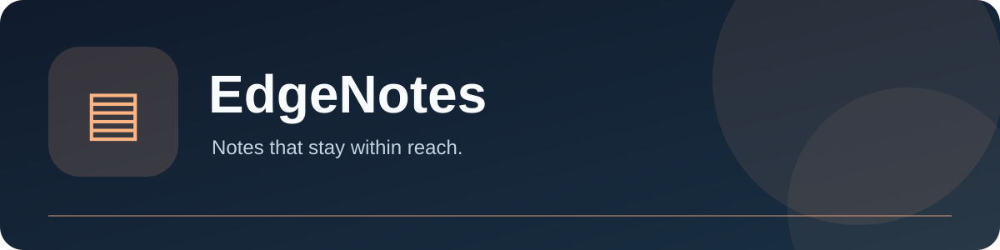

# EdgeNotes

[English](README.md) · [繁體中文](README.zh-Hant.md) · [**简体中文**](README.zh-Hans.md)



 

**随时可用的侧边笔记。** 个人 macOS 工具系列的独立 App。

## 主要功能

- 从屏幕边缘打开笔记，管理文件夹及搜索卡片。
- 按 Command–V 将图片粘贴到文字段落之间。
- 使用模板、标签、来源链接、常用目标位置、文字计算及回收站。

## 安装预览版

从 [Releases](https://github.com/yoko1234p/EdgeNotes/releases/tag/v0.8.0-preview.1) 下载 macOS ZIP，解压后将 `EdgeNotes.app` 移至“应用程序”。预览版使用临时签名，**未经 Apple 公证**。首次打开时在 Finder 右键选择“打开”；若系统阻止，请到“系统设置 → 隐私与安全性 → 仍要打开”核对。只授予所需权限，覆盖现用版本前先备份本地数据。

## 从源代码构建

```sh
cd DeskTools
APP_UI_LANGUAGE=zh-Hant swift test -j 4
bash Scripts/build.sh release
```

所需的本地 `Shared/` 包和构建工具已包含在仓库；构建不会自动安装或启动应用。

## 系统要求与限制

macOS 14 或更高版本；源代码构建需 Xcode 27／Swift 6 和 Python 3。 笔记保存在 ~/Library/Application Support/EdgeNotes/。更改存储方式前请导出重要数据。编辑器并非完整富文本或 iCloud 同步工具；计算语法有范围限制，汇率会显示更新日期。

## 参与及授权

原创应用代码按 GPL-3.0-only 发布；附带的第三方及数据许可须分别保留。详见 [LICENSE](LICENSE)、[THIRD_PARTY_NOTICES.md](THIRD_PARTY_NOTICES.md)、[CONTRIBUTING.md](CONTRIBUTING.md) 和 [SECURITY.md](SECURITY.md)。
